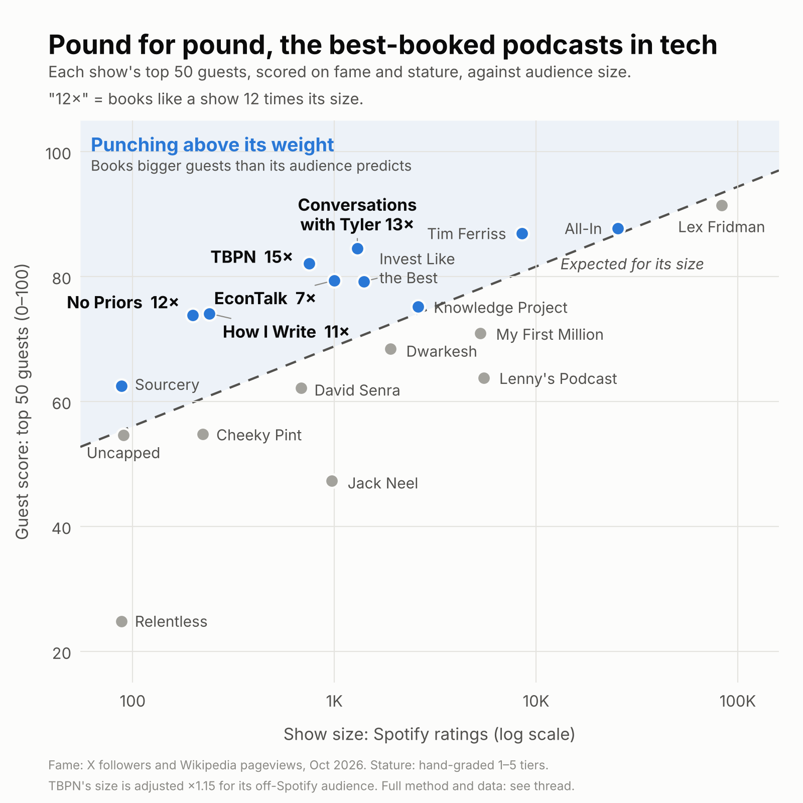

# Pound for pound, the best-booked podcasts in tech

**Which tech podcast books the most impressive guests for its size?**

I scored every guest on 19 tech and business podcasts (4,233 people, every episode ever), then compared each show's guests to its audience size.

**TBPN books like a show 15× its size.** Conversations with Tyler (13×) and No Priors (12×) are right behind.



## The ranking

| # | Show | Spotify ratings | Guest score | Pound for pound |
|---|---|---|---|---|
| 1 | TBPN | 651* | 82 | 15× |
| 2 | Conversations with Tyler | 1,300 | 84 | 13× |
| 3 | No Priors | 199 | 74 | 12× |
| 4 | How I Write | 240 | 74 | 11× |
| 5 | EconTalk | 1,000 | 79 | 7× |
| 6 | Invest Like the Best | 1,400 | 79 | 5× |
| 7 | Sourcery | 88 | 62 | 4× |
| 8 | The Tim Ferriss Show | 8,500 | 87 | 3× |
| 9 | The Knowledge Project | 2,600 | 75 | 1.2× |
| 10 | All-In | 25,400 | 88 | 1.2× |
| 11 | Uncapped with Jack Altman | 90 | 55 | 0.8× |
| 12 | Lex Fridman Podcast | 83,200 | 91 | 0.7× |
| 13 | Dwarkesh Podcast | 1,900 | 68 | 0.5× |
| 14 | David Senra | 683 | 62 | 0.5× |
| 15 | Cheeky Pint | 223 | 55 | 0.4× |
| 16 | My First Million | 5,300 | 71 | 0.3× |
| 17 | Lenny's Podcast | 5,500 | 64 | 0.07× |
| 18 | Jack Neel Podcast | 973 | 47 | 0.02× |
| 19 | Relentless | 88 | 25 | <0.01× |

\*TBPN's size is scaled 1.15× (to 749) because most of its audience watches on X and YouTube. Guest score is out of 100. "15×" means a typical show would need about 15 times TBPN's audience to book guests as heavy as TBPN's top 50.

## How it works

1. **Every guest, every episode.** Each show's full back catalogue from its RSS feed: 7,317 episodes back to 2006. Solo episodes, clips, reruns and Q&As are dropped, and a repeat guest counts once per show.
2. **Guest weight (0–100) = 50% fame + 50% stature.**
   - **Fame** is the higher of the guest's X-follower percentile (live counts, October 2026) and their English Wikipedia pageview percentile (October 2025 to September 2026). A Nobel laureate who never posts still counts as famous.
   - **Stature** is a hand-graded 1–5 tier for what the guest has achieved, scored 0 / 25 / 50 / 75 / 100. Tier 5 is a head of state, a Nobel, Turing or Fields winner, or the founder of a $100B+ company. Tier 1 is an early-stage founder or practitioner with little public record.
3. **Show score** is the average guest weight of the show's top 50 guests.
4. **Pound for pound.** A straight-line fit across the 19 shows predicts guest score from audience size: `guest score = 30.5 + 12.8 × log10(Spotify ratings)`, R² = 0.42. A show's multiple is the audience a typical show would need to book its guests, divided by its actual audience.

The full method is in [`output/methodology.md`](output/methodology.md).

## Caveats

- **Fame is measured today, not when the guest appeared.** EconTalk gets credit for Sam Altman in 2014.
- **Spotify rating counts are cumulative and a rough proxy for audience.** Older shows look bigger, and shows that live on YouTube or X are under-counted.
- **The 19 shows were hand-picked.** A different set would move the line.
- **The top 50 rewards depth.** A show with many guests picks its top 50 from a deeper pool, so the multiple measures "booked a lot of heavyweights", not hit rate per episode.
- **The top 5 is stable.** The same five shows lead with the top 25 or top 75 guests, with fame/stature weighted 35/65 or 65/35, and without TBPN's size adjustment. See [`output/robustness.md`](output/robustness.md).

## The data

| File | What it is |
|---|---|
| [`output/rankings.csv`](output/rankings.csv) | One row per show: size, guest score, expected score, pound-for-pound multiple, show type |
| [`output/guest_weights.csv`](output/guest_weights.csv) | Every guest's fame inputs, stature tier and guest weight |
| [`output/heavyweights.csv`](output/heavyweights.csv) | The 100 heaviest guests across all 19 shows, and where they appeared |
| [`data/episodes.csv`](data/episodes.csv) | All 7,317 episodes: show, date, title, description |
| [`data/guests.csv`](data/guests.csv) | One row per show and guest, with appearances and episode titles |
| [`data/stature.csv`](data/stature.csv) | Every guest's stature tier, with a one-line reason |
| [`data/guest_data.csv`](data/guest_data.csv) | Wikidata match, Wikipedia article and 12-month pageviews |
| [`data/x_followers.csv`](data/x_followers.csv) | Verified X handles and live follower counts |
| [`data/shows.csv`](data/shows.csv) | The 19 shows and their Spotify rating counts |

The remaining files in `data/` are the hand-checked corrections the pipeline applies: guest fixes, Wikidata matches, X handle overrides, stature overrides and the TBPN size adjustment.

## Reproducing it

```bash
pip install -r requirements.txt
python3 scripts/score.py          # rankings, guest weights, robustness check
python3 scripts/heavyweights.py   # top 100 guests
python3 scripts/chart.py          # the scatter (also top10_chart.py, cover.py)
```

Those steps run from the data in this repo.

The upstream steps rebuild that data from public sources:
- RSS feeds (`pull_feeds.py`, `build_episodes.py`)
- guest extraction (`extract_guests.py`, `build_guests.py`)
- Wikidata and Wikipedia pageview dumps (`wikidata_*.py`, `pageview_dumps.sh`, `build_guest_data.py`)
- X follower verification (`x_verify.py`, `build_x_followers.py`)

The raw downloads (about 4 GB of pageview dumps) aren't included.

## Missed a show?

Open an issue with the podcast you think books above its weight.
